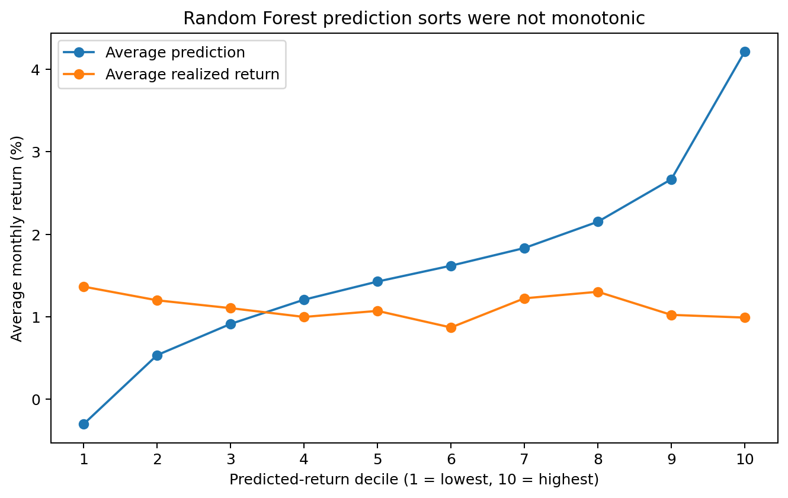
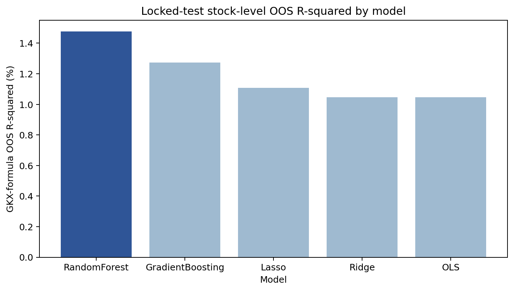
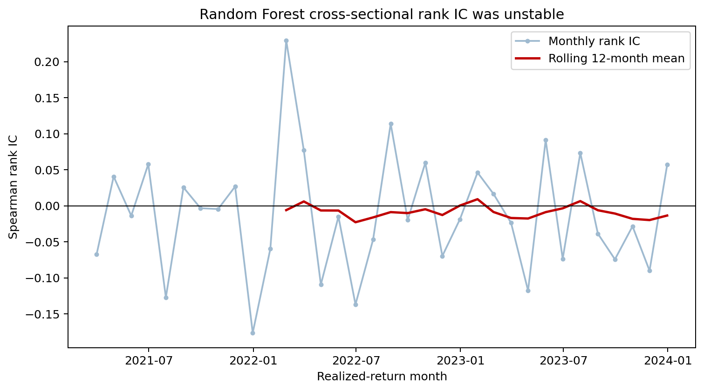
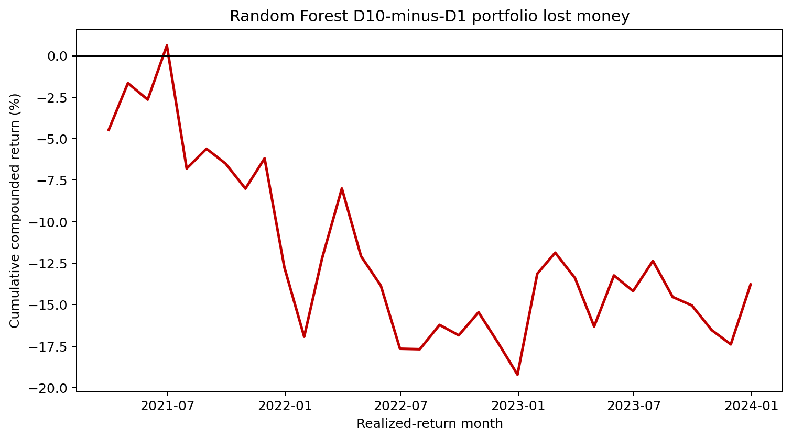

# Machine Learning for Cross-Sectional Stock Returns

### A Public-Data Replication and Extension of Gu, Kelly, and Xiu

**Research question:** Can leakage-controlled machine learning improve next-month stock-return forecasts—and does that statistical improvement produce reliable security rankings and portfolio returns?

**Classification:** Independent public-data partial replication and extension; not an exact reproduction.

Random Forest improved stock-level squared prediction error relative to a zero-return benchmark, but negative rank IC and non-monotonic portfolio sorts showed that statistical accuracy did not translate into reliable security ranking or profitable equal-weight portfolios.



> **Main result:** Random Forest achieved 1.4772% GKX-formula OOS R², while its equal-weight D10−D1 portfolio returned −0.3749% per month in the locked test.

- Validation-only model selection and a chronologically isolated 34-month locked test prevented final-test tuning.
- Mean monthly rank IC was −0.0118; only 38.2% of test months were positive.
- Realized decile returns averaged 4.79 adjacent ordering violations per month.
- The spread’s block-bootstrap 95% interval was −1.0315% to +0.2840%; costs weakened an already negative strategy.

**Methods and technology:** Python, pandas, NumPy, scikit-learn, pytest, Git, chronological validation, annual refitting, monthly cross-sectional preprocessing, saved stock-level predictions, equal-weight decile portfolios, drift-adjusted turnover, HAC inference, moving-block bootstrap, and Fama–French factor diagnostics.

**Full report:** [`docs/research_report.md`](docs/research_report.md)

## Why this project matters

Financial machine-learning projects can look successful when future information leaks into preprocessing, the final test is used to choose a winner, or predictive and portfolio metrics are treated as interchangeable. This project began with an audit of those risks, rebuilt the pipeline under a frozen protocol, and accepted the resulting negative portfolio evidence.

The contribution is therefore research validation rather than “stock-picking AI”: leakage detection, chronological model evaluation, statistical-versus-economic reconciliation, reconstructable portfolio analytics, and honest interpretation of weak results.

## Dataset

| Item | Public-data implementation |
|---|---|
| Observation unit | One stock-month |
| Raw panel | 77,988 stock-month rows |
| Universe | Fixed 497-security current-constituent panel |
| Period | January 2010–November 2023 |
| Predictors | 15 price, volatility, market-relative, and volume features |
| Target | Next-month adjusted-price raw return |
| Locked test | February 2021–November 2023 feature months |

The panel retains survivorship and historical-membership look-ahead bias. It does not represent the historical S&P 500 or broad U.S. equities.

## Methodology


No random split or shuffled cross-validation was used. All models and hyperparameters were preregistered before the locked test. Random Forest was selected on validation results only, and all five preregistered models were reported on the test.

## Results

| Metric | Random Forest locked-test result | Interpretation |
|---|---:|---|
| GKX-formula OOS R² | 1.4772% | Lower pooled squared error than forecasting zero |
| Prediction coverage | 100% | 16,797 eligible stock-month forecasts |
| Mean monthly rank IC | −0.0118 | Weak negative average cross-sectional ordering |
| Median monthly rank IC | −0.0169 | Ranking weakness was not only a mean effect |
| Positive rank-IC months | 38.2% | 13 of 34 test months |
| Mean D10−D1 return | −0.3749% monthly | Highest forecasts underperformed lowest forecasts |
| Spread bootstrap 95% interval | [−1.0315%, +0.2840%] | Mean not statistically distinguishable from zero |
| Factor intercept | +0.4508% monthly; HAC t = 1.15 | Statistically weak diagnostic, not an alpha claim |

Source: [`metric_reconciliation.csv`](results/publication_source_data/metric_reconciliation.csv), [`statistical_inference.csv`](results/publication_source_data/statistical_inference.csv), and [`factor_regressions.csv`](results/publication_source_data/factor_regressions.csv).

## Key charts

### Statistical fit did not imply ranking ability



All models reduced pooled squared error relative to zero, but that metric does not evaluate monthly ordering. Source: [`figure_1_model_oos_r2.csv`](results/publication_source_data/figure_1_model_oos_r2.csv).

### Rank IC was unstable



Mean and median monthly rank IC were negative. Source: [`figure_3_random_forest_rank_ic.csv`](results/publication_source_data/figure_3_random_forest_rank_ic.csv).

### The long-short spread lost money



The frozen D10-minus-D1 orientation was never reversed after observing the result. Source: [`figure_4_random_forest_cumulative_spread.csv`](results/publication_source_data/figure_4_random_forest_cumulative_spread.csv).

## Reproducibility

Public verification and the limits of full-data reproduction are documented in [`docs/reproducibility.md`](docs/reproducibility.md).

```powershell
python -m venv .venv
.\.venv\Scripts\python -m pip install -e .
.\.venv\Scripts\python -m pytest -q
.\.venv\Scripts\python scripts\generate_sample.py
.\.venv\Scripts\python scripts\validate_sample.py
.\.venv\Scripts\python scripts\generate_publication_tables.py
.\.venv\Scripts\python scripts\generate_publication_figures.py
.\.venv\Scripts\python scripts\check_public_links.py
.\.venv\Scripts\python scripts\scan_public_tree.py
```

## Repository structure

```text
configs/                         Public protocol summary and frozen hashes
docs/                            Report, methodology, limitations, and data access
figures/                         Five primary publication charts
results/publication_tables/      Compact public result tables
results/publication_source_data/ Machine-readable chart and headline sources
sample_data/                     Fully synthetic schema sample
scripts/                         Public validation and regeneration commands
src/gkx_public/                  Pure public validation and metric utilities
tests/                           Clean-clone public tests
```

## Limitations

- Current-constituent universe creates unresolved survivorship and membership look-ahead bias.
- Delisted securities and delisting returns are unavailable.
- Raw adjusted-price returns replace CRSP excess returns.
- Fifteen public price/volume predictors replace the paper’s 920-variable design.
- Equal weights replace the paper’s principal value-weight portfolios because reliable lagged market capitalization is unavailable.
- The locked test contains only 34 months, limiting statistical power.
- Factor results are descriptive and do not establish implementable abnormal performance.

## Original paper

Gu, Shihao, Bryan Kelly, and Dacheng Xiu. “Empirical Asset Pricing via Machine Learning.” *The Review of Financial Studies* 33, no. 5 (2020): 2223–2273. [DOI: 10.1093/rfs/hhaa009](https://doi.org/10.1093/rfs/hhaa009). The paper and appendix are cited but not redistributed.

## Disclaimer

This repository is for research and educational purposes only. It is not investment advice, does not present a profitable trading strategy, and does not claim exact reproduction or outperformance of Gu, Kelly, and Xiu.
