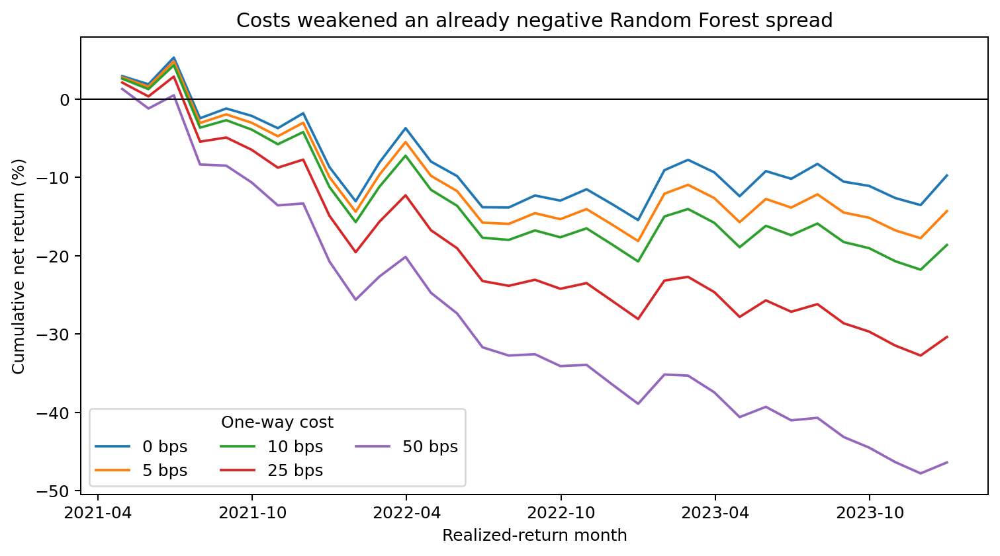

# Machine Learning for Cross-Sectional Stock Returns

## A Public-Data Replication and Extension of Gu, Kelly, and Xiu

## 1. Executive summary

This project asks whether a leakage-controlled machine-learning pipeline can predict next-month returns and produce economically useful cross-sectional rankings in a limited public equity dataset. It is an independent public-data partial replication and extension of Shihao Gu, Bryan Kelly, and Dacheng Xiu’s *Empirical Asset Pricing via Machine Learning* (2020), not an exact reproduction.

The project’s central result is a separation between statistical prediction and economic ranking. Random Forest, selected exclusively on a chronological validation period, achieved a locked-test GKX-formula out-of-sample R-squared of 1.4772%. Its pooled squared forecast error was therefore lower than the error from forecasting zero for every stock-month. However, its mean monthly Spearman rank information coefficient was −0.0118, its median rank IC was −0.0169, and only 38.2% of test months had positive rank IC. Prediction-sorted realized returns were non-monotonic, with an average 4.79 adjacent decile-order violations per month. The equal-weight top-minus-bottom portfolio returned −0.3749% per month.

Uncertainty is material. A preregistered six-month moving-block bootstrap produced a 95% interval of −1.0315% to +0.2840% for the monthly long-short spread. A Fama–French five-factor-plus-momentum regression estimated a positive 0.4508% monthly intercept, but its HAC t-statistic was only 1.15. That intercept is a statistically weak, post-hoc diagnostic over 34 months; it is not evidence of implementable alpha. Transaction costs weakened an already negative gross strategy and therefore did not explain the failure.

The strongest contribution is methodological. The original project contained full-panel preprocessing leakage, used a differently defined R-squared under a comparable label, selected a “best” model after observing test results, and lacked reconstructable predictions and portfolio weights. The corrected pipeline introduced time-local preprocessing, disjoint training/validation/locked-test periods, validation-only model selection, a zero-return OOS R-squared denominator, saved stock-level predictions, reconstructable portfolio contributions, drift-adjusted turnover, preregistered inference, and immutable artifact checks.

The results apply only to a fixed public-data universe of 497 surviving securities. The sample does not contain historical S&P 500 membership, delisted securities, delisting returns, point-in-time market capitalization, CRSP excess returns, or the paper’s full predictor design. Survivorship and membership look-ahead bias remain unresolved. The project therefore supports conclusions about internal temporal validity within this fixed panel, not unbiased historical S&P 500 performance or the broad U.S. equity market.

*Public sources: `results/publication_tables/model_predictive_performance.csv`; `results/publication_source_data/metric_reconciliation.csv`; `results/publication_source_data/rank_ic_summary.csv`; `results/publication_source_data/statistical_inference.csv`; `results/publication_source_data/factor_regressions.csv`; `results/publication_tables/top_minus_bottom_diagnostics.csv`.*

## 2. Research question

The primary research question is: **Can models trained on public stock-price and volume features improve next-month stock-return prediction, and does any statistical improvement translate into reliable cross-sectional portfolio sorting?**

This question contains separate estimands. Stock-level OOS R-squared evaluates pooled magnitude errors. Rank IC evaluates whether the cross-sectional ordering of forecasts agrees with the ordering of realized returns each month. Prediction-sorted portfolios emphasize the extreme tails and ask whether high forecasts outperform low forecasts. Factor analysis asks whether portfolio returns covary with common risk factors. Turnover and cost sensitivity address implementation drag. A model can perform differently on each dimension, so no single metric is treated as a substitute for the others.

## 3. Original paper and contribution

Gu, Kelly, and Xiu study machine learning for empirical asset pricing using monthly U.S. equities, a large characteristic set, macroeconomic interactions, and industry indicators. Their design includes 94 firm characteristics, interactions with eight macro variables, and 74 industry indicators, producing 920 predictors. They evaluate statistical forecast accuracy and prediction-sorted portfolios across a long 1957–2016 sample. The empirical design begins with 1957–1974 training, 1975–1986 validation, and 1987–2016 testing, then expands training and rolls validation forward with annual refits. The paper emphasizes chronological separation because conventional cross-validation would disrupt temporal ordering. (Gu, Kelly, and Xiu (2020), pp. 24–27, Secs. 1.8 and 2.1, Eqs. 19 and 21; Internet Appendix p. 12, Sec. D.)

The paper’s stock-level OOS R-squared compares model error with a zero excess-return forecast. It also forms monthly forecast-sorted deciles, principally using market-equity weights, and reports risk and factor diagnostics. These two evaluation channels—prediction error and portfolio outcomes—are essential to the present project. (Gu, Kelly, and Xiu (2020), p. 24, Eq. 19; pp. 40–46, Tables 7–8.)

The official authors’ repository reviewed during the private research phase primarily supplies simulation and algorithm reference code. It is not the complete empirical stock-return replication pipeline. This project’s implementation decisions were independently mapped to the published paper, Internet Appendix, author Q&A, and only then the official reference code. The third-party PDFs and unlicensed code snapshot are not redistributed. (`THIRD_PARTY_NOTICES.md`; `docs/methodology.md`.)

## 4. Replication objective

The objective was not to match the paper’s numerical tables. It was to reproduce selected methodological principles under public-data constraints: next-month stock-level prediction, chronological validation, a genuinely locked test, zero-benchmark OOS R-squared, monthly prediction sorting, and transparent comparison between statistical and economic results.

The word “replication” is therefore qualified. Formula compatibility does not imply sample comparability. The return target, universe, predictors, weighting, and period differ materially. The project is best described as a public-data partial replication and extension that tests whether the paper’s research discipline can be applied to a smaller, imperfect panel.

## 5. Public-data adaptation

The adaptation uses adjusted public price and volume data rather than CRSP and proprietary characteristic data. The target is next-month raw adjusted-price return rather than return in excess of the one-month Treasury-bill rate. Fifteen trailing price, volatility, drawdown, market-relative, and volume predictors replace the paper’s 920-variable design. Macroeconomic interactions and industry indicators are absent. Equal-weight deciles replace the paper’s principal value-weight portfolios because reliable lagged market capitalization and shares outstanding are unavailable.

These differences are not implementation shortcuts hidden from the analysis; they are explicit limits on comparability. The public-data design can test leakage controls, chronological model development, metric definitions, prediction reconstruction, and portfolio mechanics. It cannot establish that the same results would hold in the paper’s historical U.S. equity universe.

*Source: `docs/data_access.md`; `docs/methodology.md`; `docs/limitations.md`; `results/publication_tables/paper_vs_public_data_implementation.csv`.*

## 6. Dataset

The frozen panel contains 77,988 stock-month rows, 497 securities, 167 month-end dates from January 2010 through November 2023, and 15 predictors. The effective universe came from a current S&P 500 constituent collection process. The locally named `permno` field is a synthetic identifier, not CRSP PERMNO.

Predictors include 1-, 3-, 6-, and 12-month momentum; rolling volatility; downside volatility; 12-month maximum drawdown; price relative to its trailing high; moving-average gaps; trailing beta and correlation with SPY; and average monthly volume. Adjusted prices were requested through `yfinance` with `auto_adjust=True`. The target is formed by shifting the next monthly adjusted-price return back to feature month *t*.

The dataset SHA-256 is `8866aae8f7240c93da20b09a2da067b827e07861bd6af1a64e1b8ad6e028a71a`. This hash is embedded in the experiment protocol and run manifests. The data cannot be called point-in-time S&P 500 data. Missing historical membership, delisted names, delisting returns, ticker histories, and institutional data quality controls are first-order limitations.

*Source: `docs/data_access.md`; `configs/experiment_protocol_public.yaml`; `manifests/research_provenance.json`.*

## 7. Experimental design

The corrected design uses three disjoint chronological periods: training from January 2010 through April 2018, validation from May 2018 through January 2021, and locked testing from February 2021 through November 2023. The pipeline uses expanding historical information and refits at the first forecast month and each January. Random Forest was selected as the primary model only because it had the highest validation-period zero-benchmark OOS R-squared under the preregistered selection rule.

All five preregistered classical model families—OLS, Ridge, Lasso, Random Forest, and Gradient Boosting—were reported on the locked test. The test did not select the primary model, alter hyperparameters, modify features, or change portfolio orientation. The complete protocol was hashed before the locked test with SHA-256 `3a1b741bdae6220711bfe32984cc313ecc5e51c4243082998aea13fa12931ada`.

*Source: `configs/experiment_protocol_public.yaml`; `results/publication_tables/model_predictive_performance.csv`; `manifests/research_provenance.json`.*

## 8. Leakage and reproducibility controls

Phase 1 found that the old pipeline imputed remaining missing values with full-panel medians before temporal splitting. Future validation and test observations therefore influenced training inputs. It also found that the old headline R-squared used a test-sample mean denominator, test outcomes influenced “best model” language, turnover was based on constituent overlap, and stock-level predictions were not saved. The old results remain frozen as historical evidence but are retired as leakage-free performance claims.

The corrected pipeline sorts by security and date, validates unique security-month keys, centralizes target timing, asserts that realization dates follow feature dates, and fails on duplicates or invalid training cutoffs. Preprocessing is month-local: observed features are ranked within each month and mapped to [−1, 1], with missing ranked values set to zero. No global median, scaler, winsorizer, or feature selector is fitted using future months.

Every locked-test prediction stores model, security, feature date, realized-return date, forecast, realized target, split, refit date, model-training cutoff, configuration hash, and validity status. Portfolio artifacts store constituent assignments, beginning weights, realized returns, contributions, and ending drifted weights. Phase 2B reconstructed all 83,985 saved predictions and 83,985 portfolio assignments without model fitting. The final Phase 2A suite passed 27 post-run tests, and Phase 2B passed 19 diagnostic tests.

*Source: `docs/methodology.md`; `docs/limitations.md`; `manifests/research_provenance.json`.*

## 9. Models

Phase 2A retained existing model families and frozen configurations. OLS provides an unrestricted linear benchmark. Ridge and Lasso apply L2 and L1 regularization. Random Forest averages regression trees and can capture nonlinearities and interactions within the limited feature set. Gradient Boosting builds a sequential ensemble of shallow trees using the frozen legacy configuration.

No neural network, XGBoost, LightGBM, or new feature family was added. No test-driven grid search occurred. Phase 2B did not preserve fitted estimator objects, so feature importance was skipped rather than retraining solely for post-hoc explanations. This choice protects the locked test from becoming a development dataset.

*Source: `configs/experiment_protocol_public.yaml`; `docs/methodology.md`.*

## 10. Statistical evaluation

The primary metric is

`R²_OOS = 1 − Σ(r − r̂)² / Σr²`.

The zero forecast is the denominator benchmark; returns are not demeaned. This matches the formula in the paper’s Equation 19, although the public target is raw return rather than excess return. Secondary metrics include MSE, MAE, a separately labeled historical-mean-benchmark OOS R-squared, Pearson correlation, monthly Spearman rank IC, coverage, and prediction dispersion.

The distinction matters. A positive zero-benchmark OOS R-squared means that the model reduced total squared error relative to forecasting zero. It does not mean “1.48% accuracy,” a 1.48% return, or a 1.48% probability of correctness. Rank IC is a monthly cross-sectional ordering statistic. Its mean can be negative even when pooled squared error improves.

*Source: `docs/methodology.md`; `results/publication_source_data/metric_reconciliation.csv`.*

**Figure 1 takeaway:** all five preregistered models improved pooled squared error relative to zero, with Random Forest highest; the chart does not measure portfolio profitability. *Machine-readable source: `results/publication_source_data/figure_1_model_oos_r2.csv`; generator: `scripts/generate_publication_figures.py`.*

## 11. Portfolio construction

Within each model and month, securities are ordered by predicted next-month return and then by security identifier to resolve ties deterministically. Balanced deciles are assigned by row position. Each decile is equal weighted. D10 is the highest-prediction portfolio, D1 the lowest, and the long-short spread is fixed as D10 minus D1 with +100% and −100% notional exposure.

Portfolio return is the sum of saved constituent contributions. Turnover compares new target weights with prior weights after return drift over the union of old and new constituents. The first month is undefined because no prior portfolio exists. This is a weight-based measure, not a name-overlap statistic.

The equal-weight construction is a documented adaptation. Without reliable lagged market capitalization, the project does not claim to reproduce the paper’s principal value-weighted sorts. (Gu, Kelly, and Xiu (2020), pp. 42–46, Tables 7–8; `docs/methodology.md`.)

## 12. Main predictive results

Random Forest achieved a locked-test OOS R-squared of 1.4772%, MSE of 0.009057, MAE of 0.071570, and 100% prediction coverage across 16,797 eligible stock-months. Gradient Boosting produced 1.2735% OOS R-squared; Lasso 1.1080%; Ridge 1.0470%; and OLS 1.0468%.

These results are formula-comparable across this project’s models, but they should not be compared numerically with the paper as if the samples were interchangeable. The public panel is shorter, concentrated in surviving large-cap names, uses raw instead of excess returns, and contains 15 price-derived predictors rather than 920 characteristic/macro/industry inputs.

*Source: `results/publication_tables/model_predictive_performance.csv`.*

## 13. Rank-IC and decile results

Random Forest’s ranking evidence was weak. Mean monthly Spearman rank IC was −0.0118, median rank IC was −0.0169, and only 13 of 34 months—38.2%—were positive. The HAC t-statistic for mean rank IC was −1.31. The longest run of negative rank IC was four months.

**Figure 3 takeaway:** cross-sectional rank accuracy fluctuated and its 12-month average spent most of the observable window near or below zero. *Machine-readable source: `results/publication_source_data/figure_3_random_forest_rank_ic.csv`; generator: `scripts/generate_publication_figures.py`.*

Average predictions increased monotonically by construction across deciles, from approximately −0.29% in D1 to 4.22% in D10. Realized returns did not. D1 averaged 1.3660% monthly and D10 averaged 0.9911%, producing a −0.3749% spread. Monthly decile ordering contained an average 4.79 adjacent violations out of nine comparisons, and the mean realized-decile Spearman score was −0.0553.

**Figure 2 takeaway:** the bottom forecast decile outperformed the top, while realized returns showed no reliable monotonic gradient. *Machine-readable source: `results/publication_source_data/figure_2_random_forest_deciles.csv`; generator: `scripts/generate_publication_figures.py`.*

*Additional sources: `results/publication_source_data/rank_ic_summary.csv`; `results/publication_source_data/decile_monotonicity_summary.csv`; `results/publication_source_data/decile_performance_by_model.csv`.*

## 14. Statistical uncertainty

Inference was preregistered before viewing final intervals. Monthly time-series averages use Bartlett-kernel HAC inference with three lags. Bootstrap intervals use 2,000 circular moving-block draws by calendar month, six-month blocks, seed 20260714, and a 95% confidence level. Resampling whole months preserves within-month cross-sectional dependence rather than pretending that 16,797 stock-month errors are independent.

Random Forest’s OOS R-squared bootstrap interval was −3.3738% to +6.1231%. The interval’s width shows the uncertainty created by a 34-month test. The mean spread was −0.3749% per month, HAC t = −0.99, with a block-bootstrap interval of −1.0315% to +0.2840%. The interval includes zero, so the analysis does not establish a reliably negative expected spread; it establishes that the realized economic result was negative and that the data are insufficient to distinguish the mean confidently from zero.

*Source: `configs/inference_protocol_public.yaml`; `results/publication_source_data/statistical_inference.csv`; `docs/methodology.md`.*

## 15. Factor diagnostics

Official monthly U.S. Fama–French five-factor and momentum files were downloaded from the Kenneth French Data Library, hashed, converted from percentages to decimal returns, and aligned to realized portfolio months. The Random Forest D10-minus-D1 regression used the raw zero-cost spread as the dependent variable and included market, SMB, HML, RMW, CMA, and momentum.

The estimated monthly intercept was +0.4508%, with a HAC standard error of 0.3927%, t = 1.15, p = 0.251, and 34 observations. The regression also estimated positive SMB exposure and negative HML and RMW exposure. Given the short sample, post-hoc diagnostic status, survivorship bias, and membership look-ahead, the intercept is not evidence of implementable abnormal performance and is not a headline result.

*Source: `THIRD_PARTY_NOTICES.md`; `configs/inference_protocol_public.yaml`; `results/publication_source_data/factor_regressions.csv`.*

## 16. Transaction-cost sensitivity

The cost analysis applies a preregistered full grid of 0, 5, 10, 25, and 50 basis points one way to Phase 2A drift-adjusted turnover. Net return equals gross return less the cost rate multiplied by turnover. Borrow fees, financing, market impact, and asymmetric bid-ask effects are excluded.

For Random Forest, mean drift-adjusted long-short turnover was 3.1227 per month. The comparable mean net spread for recorded months was −0.2510% at 0 bps, −0.4072% at 5 bps, −0.5633% at 10 bps, −1.0317% at 25 bps, and −1.8124% at 50 bps. The 0-bps cost-table mean differs from the 34-month gross mean because the first month has undefined turnover and is excluded consistently from all cost scenarios.

**Figure 5 takeaway:** costs compound the loss but cannot explain it because the gross spread is already negative. *Machine-readable source: `results/publication_source_data/figure_5_random_forest_cost_sensitivity.csv`; generator: `scripts/generate_publication_figures.py`.*

*Additional source: `configs/transaction_cost_protocol_public.yaml`; `results/publication_tables/top_minus_bottom_diagnostics.csv`.*

## 17. Why positive OOS R-squared did not produce positive portfolio returns

OOS R-squared aggregates squared errors across every stock-month. It rewards a forecast that is closer to realized return magnitudes on average than zero, especially for observations with large target magnitude. A prediction can reduce error by estimating the common positive return level or shrinking extreme mistakes without ordering securities correctly within any month.

The portfolio asks a different question. It depends on relative ordering, particularly whether the top and bottom forecast tails separate future winners from losers. Random Forest’s pooled Pearson correlation was positive even while mean monthly Pearson IC was nearly zero and mean Spearman rank IC was negative. This pattern is consistent with aggregate magnitude information that does not translate into stable within-month ranking.

The decile evidence reinforces that explanation. Predicted values separated strongly across bins, but realized means remained clustered around roughly 0.9%–1.4% and were non-monotonic. D1 realized returns exceeded D10. Ranking failure was not corrected by reversing the sign; the D10-minus-D1 orientation was frozen before test evaluation and remained unchanged. The project accepts the unfavorable result rather than transforming the locked test into another tuning set.

**Figure 4 takeaway:** the equal-weight D10-minus-D1 portfolio ended the locked test with a compounded loss despite positive stock-level OOS R-squared. *Machine-readable source: `results/publication_source_data/figure_4_random_forest_cumulative_spread.csv`; generator: `scripts/generate_publication_figures.py`.*

## 18. Comparison with GKX

The current implementation matches or partially matches several methodological principles: next-month forecasting, chronological samples, validation-only model selection, annual refitting, zero-benchmark OOS R-squared, monthly prediction sorting, and drift-adjusted turnover. It differs materially in universe, target, period, predictors, portfolio weights, and data quality.

GKX use a broad CRSP universe and monthly excess returns. This project uses a current-survivor S&P 500-style universe and raw adjusted-price returns. GKX use 920 firm/macro/industry predictors; this project uses 15 price and volume predictors. GKX principally report value-weighted portfolios; this project reports equal weights because point-in-time market equity is unavailable. Transaction costs, rank IC, and the public-data audit are extensions rather than reproductions of the paper’s principal tables.

Consequently, the 1.4772% OOS R-squared cannot be described as outperforming GKX. Different sample composition, target construction, periods, predictors, and survivorship can materially alter the denominator and forecast difficulty. The appropriate comparison is methodological, not a horse race between headline values.

*Source: `results/publication_tables/paper_vs_public_data_implementation.csv`; `docs/paper_vs_implementation.md`.*

## 19. Limitations

The largest limitation is external universe validity. The 497-stock panel uses current constituents, so securities that failed, delisted, merged, or exited before collection are generally absent. Historical membership is unavailable, and inclusion is known using future information relative to earlier sample months. This can inflate apparent investability and distort both prediction and portfolio outcomes.

The target omits delisting returns and the risk-free deduction used by the paper. Public adjusted-price data depend on vendor adjustment conventions and may be revised. Market capitalization and shares outstanding are not available with reliable point-in-time provenance, preventing value weights. The feature set excludes accounting fundamentals, analyst information, macro interactions, and historical industry membership. The locked test contains only 34 months, making HAC and bootstrap inference imprecise.

Factor regressions are post-hoc and short. The transaction-cost grid excludes several real implementation costs. Equal-weight deciles can place more weight on smaller names than the paper’s value-weight design, though the universe itself is large-cap oriented. These limitations do not invalidate the internal leakage corrections; they constrain economic and external interpretations.

## 20. Lessons for financial machine learning

First, temporal integrity must precede model complexity. A more sophisticated estimator cannot rescue preprocessing that incorporates future information or model selection that observes the final test. Second, metric labels matter. Mean-benchmark R-squared and zero-benchmark OOS R-squared answer different questions and must not share an ambiguous label.

Third, prediction accuracy is not portfolio profitability. Magnitude error, cross-sectional ranking, tail separation, transaction costs, and factor exposure should be evaluated separately. Fourth, reconstructability changes the quality of empirical work. Saving stock-level forecasts, model cutoffs, constituent assignments, weights, contributions, and manifests makes it possible to audit every reported number.

Finally, negative results are useful when the experiment is credible. The appropriate response to weak locked-test ranking is not to retune until a positive spread appears. Any model expansion after opening this test must be labeled exploratory or evaluated on a genuinely new untouched holdout.

## 21. Reproducibility instructions

The public verification workflow is documented in `docs/reproducibility.md`. It validates the synthetic schema sample, frozen aggregate findings, publication tables, figures, links, and security hygiene. Full model training and stock-level reconstruction require excluded private analytical inputs and are documented honestly rather than simulated.

The public raw panel is hash-identified but should be reviewed before GitHub publication because redistribution and repository-size considerations differ from code reproducibility. The original GKX proprietary dataset is not included and cannot be reconstructed from this repository alone.

## 22. Conclusion

The project found a statistically positive but economically weak result. Random Forest reduced aggregate squared forecast error relative to a zero-return benchmark, but cross-sectional ranking was unstable, realized decile returns were non-monotonic, and the equal-weight long-short portfolio lost money in the locked test. The factor intercept was statistically weak, and transaction costs worsened rather than caused the result.

The defensible achievement is the research process: identifying leakage, correcting evaluation definitions, isolating validation and testing, freezing model selection, reconstructing results from saved predictions and weights, respecting monthly dependence in inference, and reporting an unfavorable answer without test-driven retuning. The result applies to a fixed public-data universe of 497 surviving securities and is neither an exact GKX reproduction nor evidence of a profitable investment strategy.

This project is for research and educational purposes only and is not investment advice.
